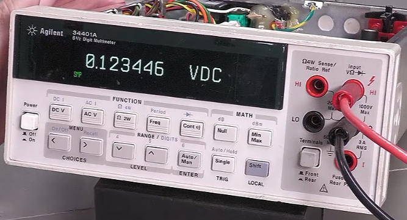

# HP 34401A TFT display upgrade - STM32 BluePill + LT7680A-R + 240x960 TFT

This is the original **Visual Studio 2022 / VisualGDB** version. The **Visual Studio Code** version is here: [34401A_VSCODE_Display](https://github.com/Ian-Johnston/34401A_VSCODE_Display)

Sniffing idea originally from here:
https://github.com/openscopeproject/HP34401a-OLED-FW/

My webpage:
https://www.ianjohnston.com/index.php/conversions/34401atftconversion

## Display hardware
- Controller: Levetop LT7680A-R (128Mb built-in SDRAM), driven by STM32 SPI1 (PA4 CS, PA5 SCK, PA6 MISO, PA7 MOSI), reset on PB10.
- TFT: BuyDisplay/EastRising ER-TFT3.71-1, 240x960, ST7701S driver, 18-bit RGB from the LT7680.
- ST7701S is initialised once at boot over a bit-banged 9-bit SPI (lcd.c, CS on PB3).

## Fixes - November 2026 (random stuck pixels / edge pixels)
1. SDRAM auto-refresh was never enabled (main cause of random pixels) - lt7680.c SDRAM_Init_LT()
   REG[E4h] was set to 0x04 first. Bit 2 (SDR_PARAMEN) switches REG[E0h]-REG[E3h] to the SDRAM
   timing-parameter registers, so the attribute, CAS latency and refresh interval values went to the
   wrong registers and refresh stayed at its default of 0000h (= refresh disabled).
   Fix: do not set bit 2. Write E0h=0x29, E1h=0x03, E2h/E3h=refresh interval, then E4h=0x01.
   Matches Levetop AP-Note V1.2 page 27.
   E0h value depends on the chip: 0x29 for 128Mb (LT7680A-R/B-R, LT7681/3/6), 0x21 for 64Mb (LT7680A/B).

2. Active Window one pixel short in each direction - lt7680.c ConfigureActiveDisplayArea_LT()
   REG[5Ah-5Dh] are the Active Window WIDTH and HEIGHT (datasheet page 158), not end coordinates.
   Writing size-1 left column x=239 and line y=959 outside the window, so they were never cleared.
   Fix: write LCD_XSIZE_TFT and LCD_YSIZE_TFT. RightWipe() is no longer needed and is disabled in main.c.

3. LT7680 busy / FIFO checks - lt7680.c and lt7680.h
   Status Register bits: bit7 = write FIFO full, bit6 = write FIFO empty, bit3 = core busy.
   New helpers: WaitForLT7680Ready() (bit3 clear), WaitForLT7680WriteFifoNotFull() (bit7 clear),
   WaitForLT7680WriteComplete() (bit6 set, then bit3 clear).
   - DrawText(): waits for idle and FIFO room before each character, and for FIFO empty + idle at the end.
   - SetTextColors() and ConfigureFontAndPosition(): wait for idle first (datasheet requires this before
     changing colour, spacing, rotation or cursor).
   - DrawLine(): waits for idle first and polls REG[67h] bit7 until the line is finished.
   All waits have timeouts so a fault cannot hang the meter.

4. WaitForTextReady() polled the wrong register - display.c
   It read REG[BAh], which is the LT7680's own SPI Master status (SPI master is disabled), so it never
   waited. It now calls WaitForLT7680WriteComplete().

## Notes for alignment (not changed)
- The ST7701S runs in RGB HV mode (C3h first byte 0x80), so it finds the picture from the sync pulses:
  C3h byte 2 = horizontal back porch, byte 3 = vertical back porch (0x10 = 16 lines).
  The LT7680 vertical back porch seen by the panel is LCD_VSPW + LCD_VBPD (currently 5 + 10 = 15;
  the EastRising demo uses 5 + 11 = 16).
- LT7680 horizontal timing registers are in 8-pixel units. REG[17h] adds a 0-15 pixel fine tune to the
  horizontal back porch (currently always written as 0).
- REG[12h] bit5 (DISP_TEST) shows a colour bar generated from the LT7680 timing only - useful for
  checking that the frame fills the glass.
- main.c has a commented-out 1-pixel test box around the full 240x960 frame (TEMP TEST block).
- LCD_Hor_Ver_Timing() and LCD_Clear() in lcd.c are not used and do not apply to the ST7701S.

Datasheets used: LT768x_DS_V42_ENG.pdf, LT768x_AP-Note_V12_ENG.pdf, ST7701S_Ver1.4.pdf.

Ian.
